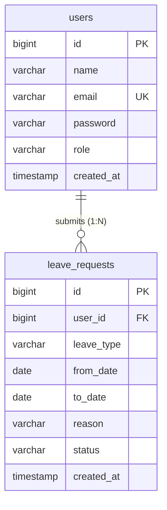

# Employee Leave Management System

A full-stack web application designed and built for the **SETTribe LLP Internship Assessment**. It streamlines the employee leave workflow with role-based access control, secure JWT authentication, and complete leave request management.

---

## 📌 Technology Stack

- **Frontend:** React.js, Vite, JavaScript (ES6+), Modern CSS (Responsive, Blue & White theme)
- **Backend:** Java 17, Spring Boot 3.4.2, Spring Security 6, Spring Data JPA, Hibernate, JJWT (0.12.6)
- **Database:** MySQL (MariaDB via XAMPP)
- **Tools:** Postman, VS Code, Git & GitHub

---

## 🌟 Key Features

### 👤 Employee Portal
1. **Secure Registration & Login:** Password hashing using BCrypt; authenticated sessions via stateless JSON Web Tokens (JWT).
2. **Apply for Leave:** Form with validation (start date cannot be in past, end date >= start date), leave type selection (`CASUAL`, `SICK`, `EARNED`, `OTHER`), reason, and real-time duration calculator.
3. **Leave Tracking:** Tabular view of personal leave requests with status badges (`PENDING`, `APPROVED`, `REJECTED`).
4. **Edit Pending Requests:** Update leave details while the request is still pending.
5. **Cancel Pending Requests:** Delete pending leave applications.
6. **Filtering:** Instant client-side filtering by status and leave type.

### 🏢 Administrator Portal
1. **Organization-wide Overview:** View all leave applications across all employees.
2. **Review Workflow:** One-click **Approve** and **Reject** buttons for pending requests.
3. **Admin Statistics:** Real-time counters for Total Submissions, Pending Review, Approved, and Rejected.
4. **Search & Filters:** Search by employee name, email, or reason; filter by status or leave type.
5. **Role Protection:** Securely guarded by Spring Security (`@PreAuthorize` / `hasRole('ADMIN')`); employees cannot access `/api/admin/**`.

---

## 🗄️ Database Architecture

The system uses two relational tables in MySQL (`settribe_leave_db`):



### Table 1: `users`
- `id` (BIGINT, Primary Key, Auto Increment)
- `name` (VARCHAR 100, NOT NULL)
- `email` (VARCHAR 150, NOT NULL, UNIQUE)
- `password` (VARCHAR 255, NOT NULL - BCrypt hashed)
- `role` (VARCHAR 20, DEFAULT 'EMPLOYEE')
- `created_at` (TIMESTAMP, DEFAULT CURRENT_TIMESTAMP)

### Table 2: `leave_requests`
- `id` (BIGINT, Primary Key, Auto Increment)
- `user_id` (BIGINT, Foreign Key referencing `users(id)` ON DELETE CASCADE)
- `leave_type` (VARCHAR 50, NOT NULL)
- `from_date` (DATE, NOT NULL)
- `to_date` (DATE, NOT NULL)
- `reason` (VARCHAR 500, NOT NULL)
- `status` (VARCHAR 20, DEFAULT 'PENDING')
- `created_at` (TIMESTAMP, DEFAULT CURRENT_TIMESTAMP)

---

## 🚀 REST API Endpoints

### 🔐 Authentication APIs
| Method | Endpoint | Description | Access |
| :--- | :--- | :--- | :--- |
| `POST` | `/api/auth/register` | Register a new employee account | Public |
| `POST` | `/api/auth/login` | Authenticate & retrieve JWT token | Public |

### 📋 Employee Leave APIs
| Method | Endpoint | Description | Access |
| :--- | :--- | :--- | :--- |
| `GET` | `/api/leaves` | List logged-in employee's leaves | Authenticated |
| `POST` | `/api/leaves` | Submit a new leave request | Authenticated |
| `PUT` | `/api/leaves/{id}` | Update a pending leave request | Owner Only |
| `DELETE` | `/api/leaves/{id}` | Cancel/delete a pending request | Owner Only |

### 🛡️ Admin Leave APIs
| Method | Endpoint | Description | Access |
| :--- | :--- | :--- | :--- |
| `GET` | `/api/admin/leaves` | View all leave requests | Admin Only |
| `PUT` | `/api/admin/leaves/{id}/status` | Approve or reject a request | Admin Only |

---

## 💻 Setup & Run Instructions

### 1. Database Setup (XAMPP / MySQL)
1. Start **Apache** and **MySQL** in XAMPP Control Panel.
2. Open phpMyAdmin at `http://localhost/phpmyadmin`.
3. Create a database named `settribe_leave_db`.
4. Import and execute `database/schema.sql`.
5. Import and execute `database/sample-data.sql`.

### 2. Backend Setup (Spring Boot)
```bash
cd backend
./mvnw clean compile
./mvnw spring-boot:run
```
Backend will start on `http://localhost:8080`.

### 3. Frontend Setup (React + Vite)
```bash
cd frontend
npm install
npm run dev
```
Frontend will be accessible at `http://localhost:5173`.

---

## 🔑 Default Test Credentials

| Role | Email | Password |
| :--- | :--- | :--- |
| **Admin** | `admin@settribe.com` | `Password@123` |
| **Employee** | `john@settribe.com` | `Password@123` |

*(You can also register any new employee account directly from the UI!)*

---

## 📝 SQL Assessment Queries
Refer to `database/queries.sql` for all 8 required assessment queries:
1. Display all users
2. Display leave requests for a user
3. Count requests by status
4. Find pending requests
5. Find approved requests ordered by date
6. JOIN users with leave requests
7. Update request status
8. Delete a pending request

